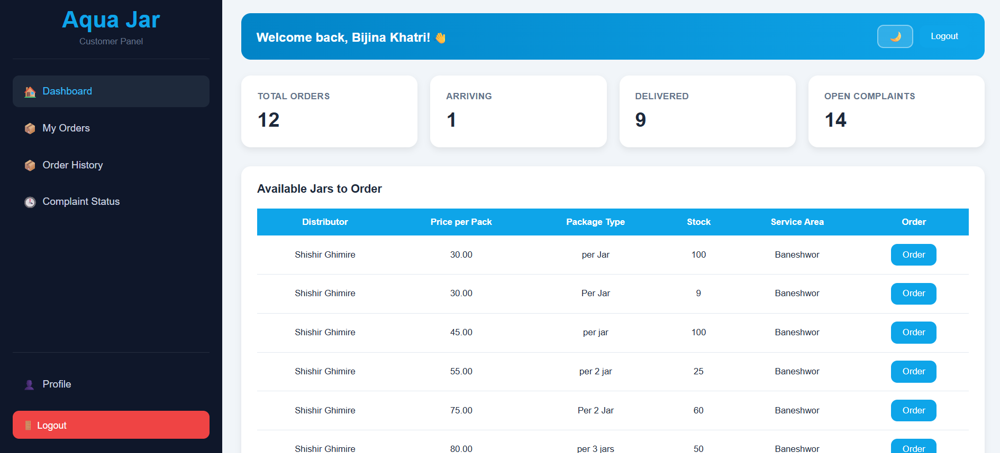
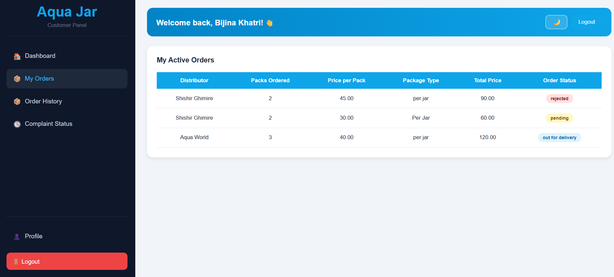
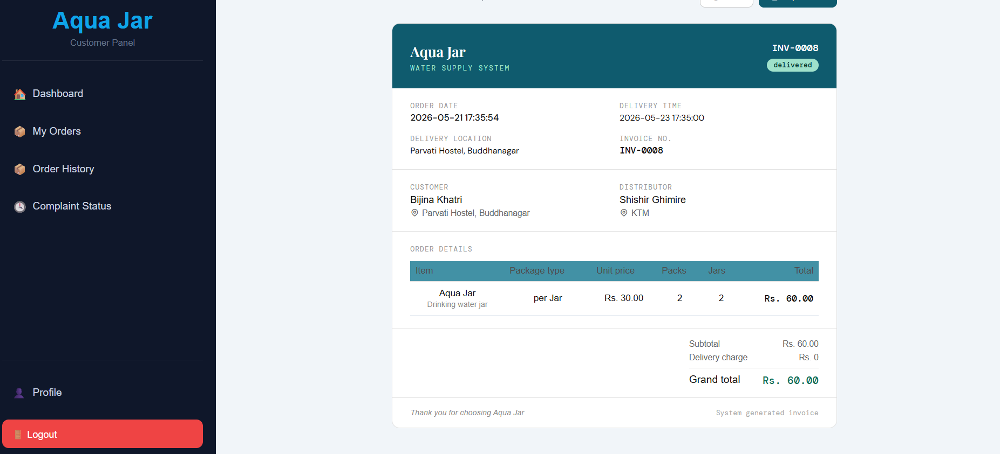
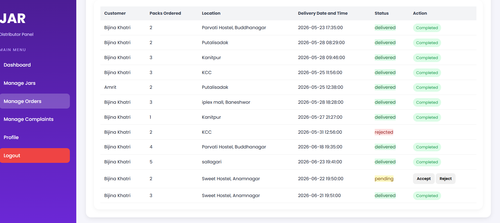

# 💧 Aqua Jar

A web-based jar water supply and complaint management system that connects households with local water distributors — digitizing the ordering, delivery tracking, pricing, and complaint resolution process.

> **Project - V (BIT306CO)** | Bachelor in Information Technology  
> Kantipur City College, Purbanchal University | May 2026

**🎥 Demo video:** [Watch the 2-minute walkthrough](https://drive.google.com/drive/folders/1nqL0l3VbAQRTVsN1zZ6cl1api7yHz_Al?dmr=1&ec=wgc-drive-%5Bmodule%5D-goto)
*Runs locally with XAMPP; there is no live deployment.*

---
## 📸 Screenshots

| Customer: place an order | Order tracking |
|---|---|
|  |  |

| Invoice | Distributor dashboard |
|---|---|
|  |  |  

---
## 👥 Team

| Name              | Roll No. | Responsibilities                                       |
| ----------------- | -------- | ------------------------------------------------------ |
| Bijina Khatri     | 350548   | Backend, Database, Auth, DFD, Literature Review        |
| Rinkesh Chaudhary | 350568   | Customer Dashboard, Use Case & ER Diagram, Methodology |
| Shishir Ghimire   | 350576   | Distributor Dashboard, Feasibility Study, Introduction |

**Supervisors:** Mr. Bimochan Khadka & Er. Maryada Karki

---

## 🚩 Problem Statement

In Nepal, jar water ordering is mostly phone-based with no digital record-keeping. This causes:

- Delayed or missed deliveries due to miscommunication
- No transparency on pricing or water source
- Difficult complaint tracking for customers
- Inefficient order and customer management for distributors

---

## ✨ Features

- **Role-based Login** — Separate dashboards for Customers and Distributors
- **Jar Ordering** — Browse distributors, compare pricing, and place orders
- **Order Tracking** — Real-time status updates: Pending → Confirmed → Out for Delivery → Delivered
- **Order History** — Full record of past orders per customer
- **Invoice Generation** — View and download invoice with order details and total price
- **Complaint Handling** — Customers submit complaints; distributors view and resolve them
- **Price Transparency** — Displays refill cost and service charges across distributors
- **Confirmation Messages** — Inline feedback for all key actions

---

## 🛠️ Tech Stack

| Layer     | Technology                  |
| --------- | --------------------------- |
| Frontend  | HTML, CSS, JavaScript       |
| Backend   | PHP (server-side scripting) |
| Database  | MySQL (via mysqli / PDO)    |
| Dev Tools | VS Code, XAMPP              |

**Architecture:** 3-layer — Presentation → Application (Business Logic) → Database

---

## 🗂️ System Design

The system follows a **Modified Waterfall Model** with four phases:

1. **Requirements** — Role-based login, ordering, delivery tracking, complaint management
2. **Design** — Database schema, UI mockups, system workflow
3. **Implementation** — Core features first (auth, orders), then complaint handling and delivery updates
4. **Testing & Debugging** — Unit and integration testing across all modules

### Modules

- `Login & Registration` — Signup, session management, role-based redirect
- `Customer Module` — Browse jars, place orders, track delivery, submit complaints, download invoices
- `Distributor Module` — Manage inventory, process orders, update delivery status, resolve complaints

---

## 🗄️ Database Entities

`customer` · `distributor` · `jar` · `orders` · `complaints`

Key relationships:

- A customer **places** many orders
- An order **has** one jar
- A distributor **posts** many jars
- A distributor **resolves** many complaints

---

## ⚙️ Setup & Installation

### Prerequisites

- [XAMPP](https://www.apachefriends.org/) (Apache + MySQL + PHP)
- VS Code or any code editor

### Steps
1. Clone the repository
   ```bash
   git clone https://github.com/Bijina09/Aqua-Jar.git
   cd Aqua-Jar
   ```
2. Move the `Aqua-Jar` folder into XAMPP's `htdocs`
   (Windows: `C:\xampp\htdocs\Aqua-Jar`)
3. Start Apache and MySQL in the XAMPP Control Panel
4. Import the database
   - Open http://localhost/phpmyadmin
   - Create a database named `aquajardb`
   - Import the `.sql` file from the `/database` folder
5. Check the DB connection in `backend/config/db.php` and update if needed:
   ```php
   $host = "localhost";
   $dbname = "aquajardb";
   $username = "root";
   $password = "";
   ```
6. Open http://localhost/Aqua-Jar/frontend/auth/login.html

---

## 🧪 Testing

Testing was performed using VS Code and browser developer tools. All modules passed functional testing:

| Module               | Tests                                                               |
| -------------------- | ------------------------------------------------------------------- |
| Login & Registration | Validation, session protection, password hashing, role redirect     |
| Customer Module      | Profile edit, jar browsing, order placement, invoice view           |
| Distributor Module   | Profile update, jar posting, order processing, complaint resolution |

---

## 🔭 Future Improvements

- Real-time GPS delivery tracking
- Online payment integration
- Automated demand prediction and analytics
- Mobile application (Android/iOS)
- Scalability improvements for larger deployments

---

## 📚 References

- [Aqua World Nepal](https://www.aquaworld.com.np/shop/address)
- [E-Vision Jar Management System](https://evisionsystems.in/jar_management.html)
- [VSP Softtech Jar Management System](https://vspsofttech.com/jar-mgmt-system.html)

---

## 📄 License

This project was developed for academic purposes under Purbanchal University.
